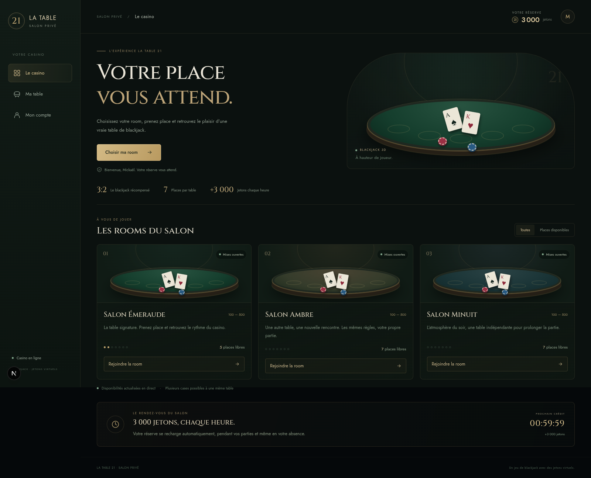
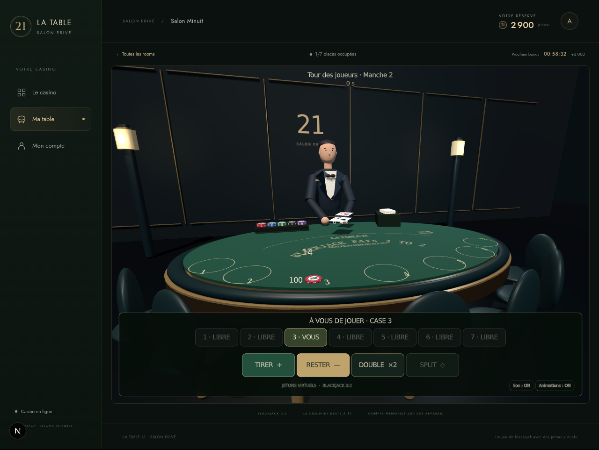
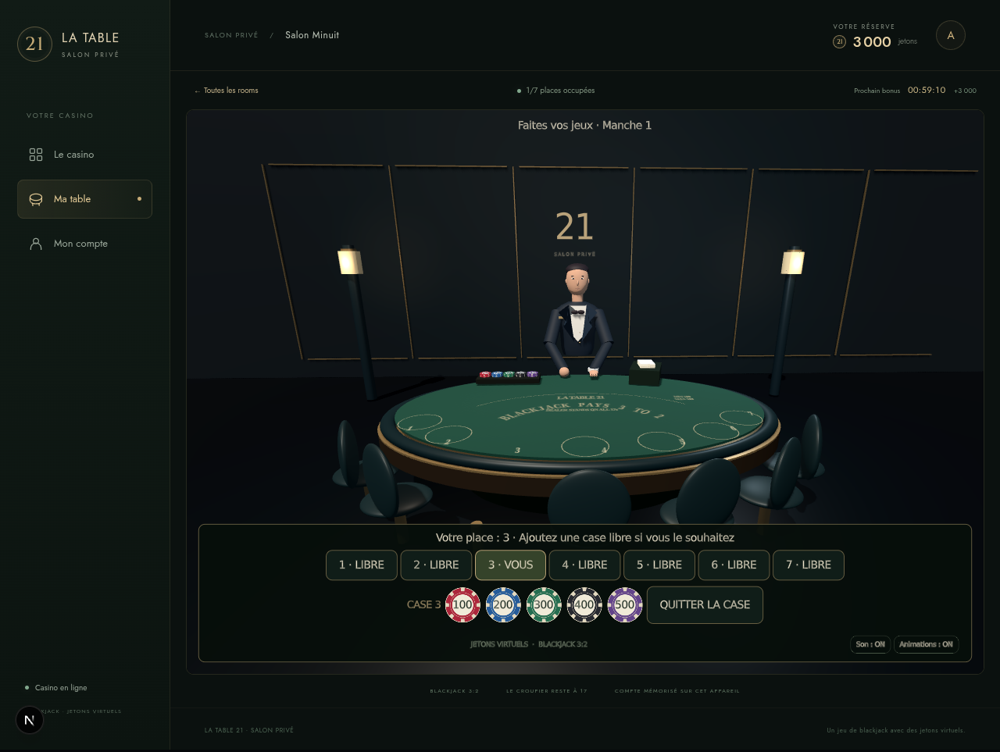
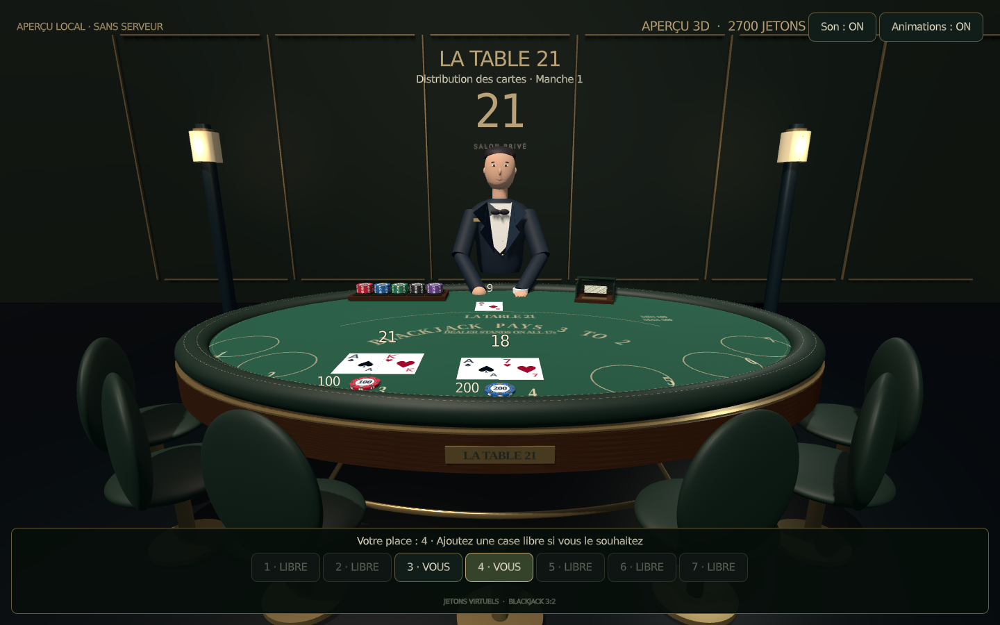
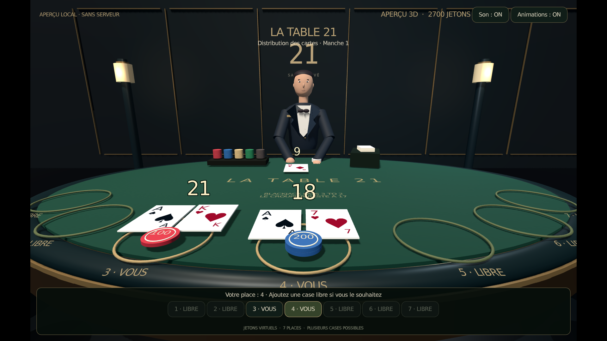

# La Table 21 — Godot 3D + serveur multijoueur

Le jeu est désormais réalisé dans **Godot 4.6**, avec un export WebGL 2 affiché à `/table`. Le serveur Node/Socket.IO existant conserve les règles, les places, les soldes et les résultats. Le navigateur et les applications natives Godot peuvent rejoindre la même table.

## Démarrer

Installer Node 24 LTS, Godot **4.6.3** et les modèles d’export de la **même version** (Godot : Éditeur → Gérer les modèles d’export).

```bash
npm ci
npm run game:export
npm run dev
```

Ouvrir http://localhost:3000 et choisir un pseudo. Le compte est mémorisé sur cet appareil. `GODOT_BIN` permet de sélectionner un autre chemin vers l’exécutable Godot.

Pour travailler dans l’éditeur, importer `godot/project.godot`, puis lancer la scène `scenes/casino.tscn` avec F6. Le serveur doit rester démarré. En ligne de commande :

```bash
godot --path godot -- --server=ws://127.0.0.1:3000 --pseudo=Mickael
```

`--demo` affiche une scène locale de démonstration clairement identifiée, sans multijoueur ni fausses transactions. `--reduced-motion` désactive les animations ; les boutons Son et Animations permettent aussi de les régler en jeu.

## Expérience de jeu

- Une salle et une table **en vraie 3D**, avec plateau compact, tapis vert à microtexture, habillage en noyer et accoudoir en cuir à double couture. Un filet de laiton, un double piètement et un repose-pieds relié à ses supports complètent le mobilier. Le sabot incliné et le plateau de jetons sont modélisés séparément. Le tapis porte des marquages plats : cases numérotées dont le cercle disparaît dès qu’une place est occupée, mentions du blackjack en arc, règle du croupier à 17 et mises 100–500, dans une typographie serif.
- Caméra basse face à la table, déplacement animé vers une place confirmée par le serveur. Cliquer sur un cercle du tapis ou sur un bouton de place pour s’asseoir.
- Places libres, personnelles et occupées distinctes. La prise d’une place occupée est rejetée côté serveur.
- Possibilité de réserver plusieurs cases libres ; sélectionner une de ses cases dans la barre, puis choisir sa mise. Chaque case a sa propre main, sa pile de jetons et son résultat.
- Jetons en argile satinée avec huit repères ivoire, tranches striées et médaillon central. Les piles reposent sur le tapis, leurs valeurs additionnées correspondent à la mise et un petit montant orienté vers le joueur reste lisible.
- Cartes fines et rapprochées, valeurs et symboles contrastés, total discret et lisible juste au-dessus de chaque main (indépendant pour les cases et mains séparées). Le total du croupier exclut toute carte encore cachée.
- Cartes 3D distribuées depuis les mains du croupier, jetons qui se posent, mouvement du bras synchronisé aux distributions, respiration et sons synthétisés.
- Tirer, rester, doubler et séparer selon les possibilités de la main active, avec délai de décision et résultats du serveur.
- Reconnexion automatique avec identité conservée dans le stockage utilisateur Godot/IndexedDB. Les actions restent désactivées pendant la déconnexion.

Le rendu active l’anticrénelage MSAA, le filtrage anisotrope et les polices 3D MSDF. La bordure et les sièges sont arrondis, le costume et le visage utilisent des surfaces à normales lissées, et l’éclairage neutre conserve les couleurs du tapis et du laiton.

La direction visuelle actuelle est **stylisée et procédurale** : le croupier est constitué de maillages Godot animés, pas d’un humain photoréaliste ni d’un personnage capturé. Les formes et matériaux sont des bases modifiables dans le projet ; aucun service de génération ou asset payant n’est nécessaire.

## Aperçu de la plateforme







Captures réelles du navigateur : accueil et tables réseau.

## Table bois, cuir et tapis vert



Capture WebGL de la scène locale de démonstration, sans transactions réseau.

## Aperçu du rendu



Capture réelle de l’export WebGL en 1920×1080, en mode démonstration local. Les cartes de cet aperçu illustrent la scène ; il ne s’agit pas d’une partie réseau enregistrée.

## Architecture

| Emplacement | Rôle |
| --- | --- |
| `godot/project.godot` | Projet source Godot 4.6 |
| `godot/scripts/casino.gd` | Scène 3D, caméra, cartes, jetons, animations et commandes |
| `godot/scripts/casino_network.gd` | Client Socket.IO v4 / Engine.IO v4 sur WebSocket, namespace par défaut |
| `src/server/game-manager.ts` | Moteur autoritaire de blackjack |
| `src/server/socket-server.ts` | Rooms et événements temps réel |
| `src/server/rooms.ts` | Trois tables indépendantes et changements de room |
| `src/server/store.ts` | Comptes, soldes, bonus et mises en SQLite |
| `src/components/platform/CasinoPlatform.tsx` | Accueil, rooms, compte et cadre du jeu |
| `src/app/table/page.tsx` | Intégration de l’export Godot dans le site |
| `scripts/export-godot.mjs` | Import et export Web sans threads |
| `.github/workflows/godot-web.yml` | Construction et vérifications, avec artefact Web téléchargeable |

L’ancien affichage React reste dans `src/components/casino` comme référence, mais n’est plus utilisé par `/table`. Le jeu Godot n’utilise plus la photo fixe de table.

L’export n’utilise pas de threads : **pas d’en-têtes COOP/COEP exigés**. Il requiert WebGL 2 et WebAssembly. Servir ensemble tous les fichiers de `public/game`, y compris `.wasm` et `.pck`. En production HTTPS, le client sélectionne automatiquement `wss://` sur le même hôte. Le proxy d’hébergement doit transmettre les upgrades WebSocket de `/socket.io/`.

## Construire et vérifier

```bash
npm test
npm run build
# Avec le serveur démarré, sur une table libre :
npm run test:godot
godot --headless --path godot --script tests/scene_test.gd
godot --headless --path godot --script tests/cards_test.gd
godot --headless --path godot --script tests/chips_test.gd
godot --headless --path godot --script tests/interface_test.gd
```

`npm run build` exporte Godot, puis construit Next.js. Le pipeline GitHub installe Godot et ses templates et fournit un artefact `la-table-21-godot-web`. Les fichiers générés dans `public/game/` ne sont pas versionnés. Pour mettre à jour le rendu local après une modification Godot, relancer `npm run game:export`.

Les tests couvrent les réservations multiples, le refus des places occupées, les mises et remboursements indépendants, les doubles débits, les montants invalides et l’interdiction de quitter/annuler pendant la manche. Les tests Godot vérifient le transport réel, une manche complète à deux cases et les objets créés dans la scène.

## Règles et limites actuelles

Blackjack européen sans carte cachée initiale (ENHC). Croupier reste à 17 ; blackjack 3:2. Split sur deux rangs identiques, sans resplit ; une carte pour les as séparés. Double sur deux cartes si le solde suffit. Mises de 100 à 500 jetons virtuels.

Trois rooms indépendantes partagent le portefeuille du compte : Émeraude, Ambre et Minuit. Leurs places et leur phase sont affichées en direct. Une manche engagée doit se terminer avant de changer de room. Une reconnexion conserve les places pendant 90 secondes.

Les comptes, gains, statistiques et crédits horaires sont enregistrés en **SQLite**. Chaque compte reçoit 3 000 jetons par heure écoulée depuis sa création, même hors connexion ; les heures manquées sont rattrapées une seule fois au retour. Les mises interrompues par un redémarrage sont remboursées. Les tables en cours sont recréées après un redémarrage. Le compte utilise un identifiant secret mémorisé dans le navigateur : conserver les données du site sur cet appareil pour le retrouver. Il n’y a pas de connexion SMS ni de récupération sur un autre appareil.

Le client n’ajoute ni argent réel ni système de paiement. Le projet nécessite encore des modèles et animations d’artiste pour une direction photoréaliste, et une validation sur de vrais appareils mobiles pour les performances/touches/clavier virtuel.

La police embarquée DejaVu Sans est distribuée avec sa licence dans `godot/assets/FONT-LICENSE.txt`. Les inscriptions du tapis utilisent Liberation Serif Bold, dont la licence figure dans `godot/assets/FELT-FONT-LICENSE.txt`.

## Déployer avec sauvegarde persistante

Le Dockerfile construit Godot 4.6.3 et Next.js, puis démarre le serveur avec Node 24 sur le port 8080. Railway détecte le Dockerfile ; configurer la route de santé `/api/health` dans les paramètres du service. Aucun moteur Godot ni téléchargement n’est nécessaire au démarrage du conteneur final.

Sur Railway, monter un volume persistant à **`/data`** et définir `TABLE21_DATABASE_PATH=/data/table21.sqlite`. Utiliser **une seule instance** sans chevauchement entre versions : les rooms sont en mémoire et cette base SQLite appartient à un seul processus. Sans volume, une nouvelle image perdrait les comptes. Ne pas ouvrir un second serveur sur la même base pendant une partie. Sauvegarder le volume avec les outils d’hébergement. Les anciens comptes de la version en mémoire ne sont pas migrés automatiquement.

Pour une installation locale, le fichier est créé dans `data/table21.sqlite` (ignoré par Git). Les tests Node utilisent une base isolée en mémoire.
